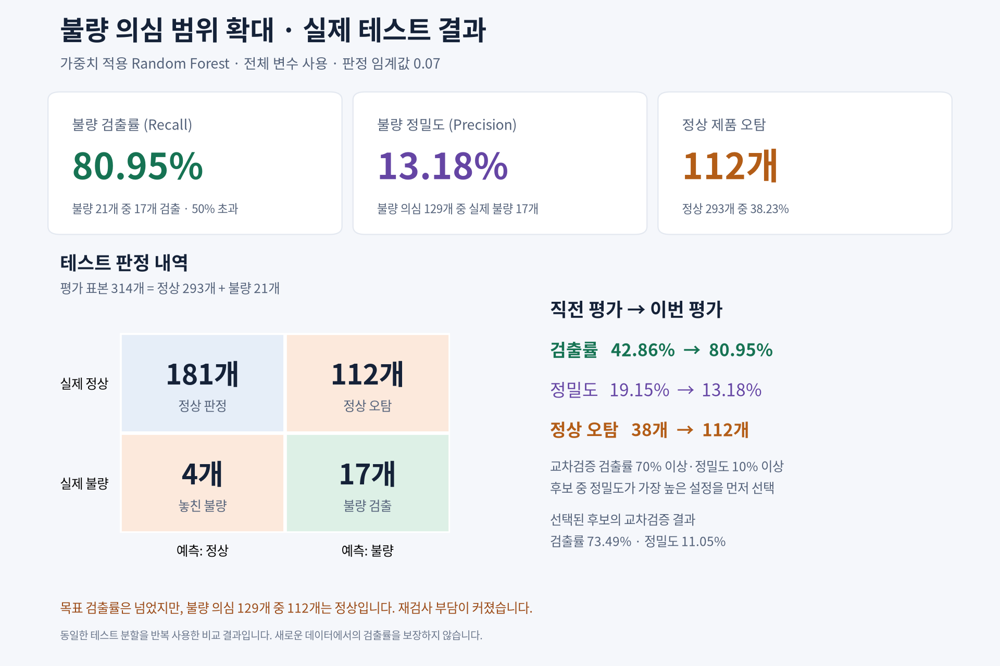

# 2026-capstone-design

SECOM 데이터의 불량 검출 실험입니다. 기존 Random Forest, XGBoost, Logistic Regression으로 전처리와 판정 임계값을 비교합니다.

## 코드와 실행 결과

- [전체 실험 노트북](수정용_캡스톤디자인.ipynb): 1~4번 셀을 순서대로 실행합니다.
- [최신 실행 출력](results/recall_target_70/executed.ipynb)
- [최신 결과 및 검증 방법](results/recall_target_70/README.md)
- [결과 화면 PDF](results/recall_target_70/test_results.pdf)
- [전처리 비교 기록](results/preprocessing_comparison.md)

현재 선택 기준은 **교차검증 검출률 70% 이상·정밀도 10% 이상인 후보 중 정밀도 최대화**입니다. 테스트 평가 전에 설정을 고정합니다. 이 기준은 테스트 성능을 보장하지 않습니다.

| 최신 테스트 결과 | 값 |
|---|---:|
| 불량 검출률 | 80.95% (17/21개) |
| 정밀도 | 13.18% (17/129개) |
| 놓친 불량 | 4개 |
| 정상 제품 오탐 | 112/293개 |

검출률이 높아진 만큼 정상 제품의 재검사 부담도 커졌습니다. 같은 테스트 분할을 여러 실험에서 반복 사용한 결과이므로 새로운 평가 데이터에서도 확인해야 합니다.



## 검증

필요한 패키지가 설치된 Python 환경에서 다음 명령으로 전처리 및 후보 선택 테스트를 실행합니다. 실제 실행에 사용한 패키지 버전은 결과 폴더의 `metrics.json`에 기록되어 있습니다.

```bash
python -m unittest discover -s tests -v
```

결과 폴더의 보조 실행 스크립트와 실행 출력 노트북은 검증 당시 클라우드 경로를 사용합니다. 다른 환경에서 전체 실험을 재현하려면 루트의 전체 실험 노트북을 사용하세요.
